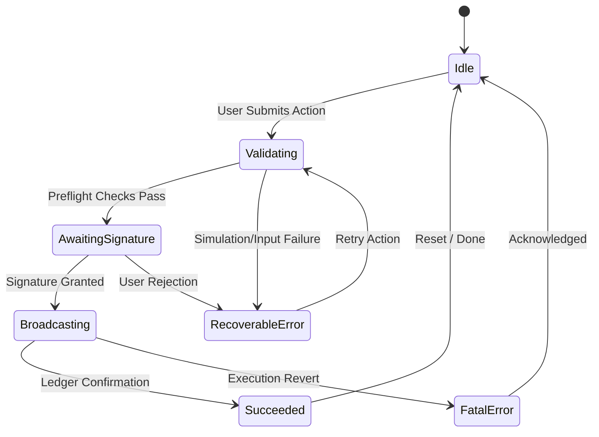

# Accessibility Coverage: Keyboard, Focus, and Async Status States (Issue #296)

## 1. Overview & Objectives

In decentralized web3 applications, users frequently encounter complex multi-step transaction lifecycles — wallet connection, input validation, hardware wallet signature prompts, asynchronous ledger broadcasting, and final settlement confirmation.

Without explicit accessibility coverage:
- Screen readers fail to announce background transaction settlement or sudden execution errors.
- Focus is lost when wallet popups close, disorienting keyboard-only users.
- Fast-paced animations and loading spinners fail WCAG 2.1 AA standards for cognitive and motor accessibility.

The **Trellis Accessibility Framework** provides contract-level deterministic state models (`shared::accessibility`) paired with client implementation patterns to ensure 100% WCAG 2.1 AA compliance across all user interfaces interacting with Trellis contracts.

---

## 2. Async Status State Taxonomy & ARIA Mapping

Every transaction or asynchronous contract operation transitions through standardized lifecycle states:

### State-to-ARIA Matrix

| Async State | `aria-live` | `role` | `aria-busy` | Focus Mode | WCAG Semantic Announcement |
| :--- | :--- | :--- | :--- | :--- | :--- |
| **Idle** | `off` | `region` | `false` | Linear Tab | Quiet state. Form elements interactive. |
| **Validating** | `polite` | `progressbar` | `true` | Linear Tab | "Validating transaction parameters and preflight safety..." |
| **AwaitingSignature** | `polite` | `status` | `true` | Modal Trap | "Please confirm and sign transaction in your Stellar wallet." |
| **Broadcasting** | `polite` | `progressbar` | `true` | Modal Trap (Locked) | "Broadcasting transaction to Soroban network..." |
| **Succeeded** | `polite` | `status` | `false` | Focus Return | "Transaction confirmed successfully. Block ledger sequence recorded." |
| **RecoverableError** | `assertive` | `alert` | `false` | Modal Trap | "Transaction failed: Insufficient allowance. Press Retry or Cancel." |
| **FatalError** | `assertive` | `alert` | `false` | Modal Trap | "Critical transaction revert. Operation halted." |

---

## 3. Focus Trapping & Management

When transactions enter modal verification states (`AwaitingSignature`, `RecoverableError`, `FatalError`):
1. **Focus Trap Containment**:
   - Focus is automatically trapped within the modal container.
   - Pressing <kbd>Tab</kbd> on the last interactive element loops to the first interactive element.
   - Pressing <kbd>Shift</kbd> + <kbd>Tab</kbd> on the first interactive element loops to the last interactive element.
2. **Initial Focus**:
   - Automatically focused on the primary confirmation action button (or error dismissal button).
3. **Focus Restoration**:
   - The triggering button's DOM identifier (`return_focus`) is stored in the contract/client metadata.
   - Upon completion or dismissal, focus returns smoothly to the trigger element, preventing focus loss.
4. **Broadcasting Lock**:
   - During `Broadcasting`, `dismissable` is set to `false`, preventing accidental escape key dismissal while state is writing to the ledger.

---

## 4. Keyboard Navigation: Roving Tabindex

For multi-item asset selectors (e.g. NFT marketplace grids, vault selection, token lists):
- `Single Tab Stop`: The container has one tab stop (<kbd>Tab</kbd> enters, <kbd>Tab</kbd> exits).
- `Active Item`: The selected item maintains `tabIndex="0"`.
- `Inactive Items`: All other items maintain `tabIndex="-1"`.
- `Arrow Navigation`:
  - <kbd>&rarr;</kbd> / <kbd>&darr;</kbd>: Focus next item.
  - <kbd>&larr;</kbd> / <kbd>&uarr;</kbd>: Focus previous item.
  - <kbd>Home</kbd>: Jump to first item.
  - <kbd>End</kbd>: Jump to last item.

---

## 5. Execution Paths

1. **Normal Path**:
   - `Idle` &rarr; `Validating` (`aria-busy="true"`) &rarr; `AwaitingSignature` (Modal Trap active) &rarr; `Broadcasting` (dismissal locked) &rarr; `Succeeded` (focus restored to trigger button).
2. **Failure Path**:
   - `Broadcasting` fails &rarr; `FatalError` triggered with `aria-live="assertive"` and `role="alert"`. Screen reader interrupts ongoing speech to alert user.
3. **Retry Path**:
   - `RecoverableError` gives retry option. User selects retry &rarr; transitions back to `Validating`.
4. **Authorization Path**:
   - `record_accessibility_state` requires authorized caller signature, preventing unauthorized tampering with client auditing events.

---

## 6. Backwards Compatibility & Rollback

- Zero storage schema migration required.
- All accessibility data structures (`shared::accessibility`) are additive helper models.
- Client applications can consume accessibility metadata without requiring protocol hard forks.

---

## 7. Regression Coverage (Dense Forms, Tables, Error Recovery)

The following tests in `shared/src/test_accessibility.rs` guard the core workflows against regressions:

| Test | Core workflow | What it guards |
| :--- | :--- | :--- |
| `test_normal_lifecycle_state_progression` | Normal transaction lifecycle | ARIA live/role/busy mapping for each state |
| `test_failure_path_uses_assertive_alert` | Fatal error | Assertive announcement + modal trap |
| `test_retry_path_recoverable_error_to_retry` | Recoverable error -> retry | Dismissable alert -> polite busy state |
| `test_focus_trap_validation` | Focus trap config | Active traps require focus targets |
| `test_dense_form_keyboard_reachability_and_focus_order` | Dense forms | Unique controls + stable return focus |
| `test_dense_table_roving_tabindex_invariants` | Dense tables | Exactly one tab stop + bounded Home/End |
| `test_error_announcement_regression_guard` | Error announcement | Assertive alert, not busy, trapped |
| `test_error_recovery_restores_focus_and_announcement` | Error recovery flow | Focus restoration + polite success |
| `test_reduced_motion_preserves_announcements` | Reduced motion | Announcements survive motion reduction |
| `test_screen_reader_announcement_coverage` | Screen reader | Non-idle states always announce |
| `test_focus_trap_rejects_invalid_active_config` | Focus trap rejection | Fail closed on missing focus targets |
| `test_record_and_retrieve_error_state` | Storage round-trip | Error state survives reload |
| `test_accessibility_metadata_public_shape` | Backwards compat | Public field set remains constructible |
| `test_accessibility_error_interface` | Error type stability | Error enum remains debuggable |

## 8. Operational Edge Cases & Failure Modes

| Edge case | Failure mode | Mitigation |
| :--- | :--- | :--- |
| Dense form re-renders during validation | Focus jumps to top of form | Contract returns stable `return_focus`; client restores focus on state change |
| Duplicate control identifiers | Focus order becomes ambiguous | Test asserts unique identifiers in dense forms |
| Roving tabindex drifts to multiple tab stops | Keyboard users get stuck in table | Test asserts exactly one tab stop per active item |
| Error announcement suppressed by reduced motion | Silent failure for screen readers | Test asserts announcements survive motion reduction |
| Active focus trap with missing targets | Focus escapes modal or disappears | `validate_focus_trap_config` returns error; client fails closed |
| Storage record failure during error state | Announcement lost on reload | Test asserts error state round-trips through record/retrieve |
| Unknown / future state value | Client cannot map to ARIA | Clients must default to assertive alert and request manual review |

## 9. Rollback & Recovery Procedure

1. **Detect regression**: CI runs `shared/src/test_accessibility.rs`. A red test identifies the affected core workflow.
2. **Contain impact**: Accessibility metadata is additive; revert the client consumer change or the contract mapping change without a storage migration.
3. **Restore focus behavior**: Revert to the last known-good contract version; clients restore focus to the stored `return_focus`.
4. **Verify**: Re-run the full accessibility test suite and manually verify keyboard-only and screen-reader flows before release.
5. **Communicate**: Note the rollback in the release changelog; no on-chain state is mutated by accessibility metadata.
