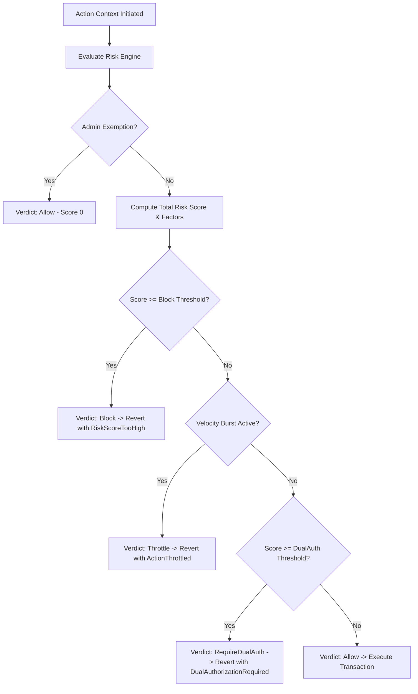

# Explainable Risk Scoring for Suspicious High-Impact Actions (Issue #298)

## 1. Overview & Rationale

Across the Trellis Soroban smart contract ecosystem—including Treasury withdrawals, Escrow releases/refunds, Upgradeability, Governance role elevation, Rebalancer operations, and multi-action Batch invocations—privileged and high-value mutations carry substantial systemic risk.

Traditional on-chain defense mechanisms rely on either:
1. **Binary Allow/Deny gates**: Rigid rules that either block valid edge cases or fail to catch subtle multi-step exploits.
2. **Opaque numeric scores**: Black-box scoring numbers without auditability, making debugging, operational triage, and indexer parsing difficult.

The **Explainable Risk Scoring Engine** (`shared::risk_scoring`) resolves these limitations by calculating a transparent, multidimensional risk assessment on a normalized 0–1000 scale. Crucially, every evaluation returns a structured breakdown of contributing **Risk Factors** detailing baseline expectations versus observed parameters, mapped directly to actionable protocol verdicts.

---

## 2. Core Architecture & Scoring Scale

### 2.1 Score Range and Risk Tiers

The overall risk score is computed on a 0–1000 basis points scale:

| Tier | Score Range | Default Protocol Verdict | Operational Description |
| :--- | :--- | :--- | :--- |
| **Minimal** | 0 – 199 | `Allow` | Normal transaction activity well within established parameters. |
| **Low** | 200 – 399 | `Allow` | Minor anomalies detected (e.g. minor dormancy) but within safety margins. |
| **Medium** | 400 – 599 | `RequireDualAuth` | Elevated risk profile (e.g. large amount or new counterparty); requires secondary co-signature. |
| **High** | 600 – 799 | `RequireDualAuth` or `Throttle` | Significant anomaly or velocity burst; requires throttling or strict governance signoff. |
| **Critical** | 800 – 1000 | `Block` | Extreme risk indicators; transaction rejected with `RiskScoreTooHigh`. |

### 2.2 Explainable Risk Factors

Each assessment returns a vector of structured `RiskFactor` records containing:
- `factor_type`: Classification of the observed risk dimension.
- `score_weight`: Number of risk points contributed to the overall score.
- `threshold`: Configured policy baseline or safety limit.
- `observed`: Concrete runtime value encountered during execution.
- `explanation`: Human- and indexer-readable string explaining the risk trigger.

Supported Risk Factor dimensions:
1. **`ExcessiveAmountRatio`**: Ratio of requested transaction volume to total contract reserve or reference limit.
2. **`VelocitySpike`**: Rate of state-changing transactions per ledger sequence window.
3. **`UnrecognizedRecipient`**: Destination account without prior verifiable ledger interaction history.
4. **`UnusualDormancy`**: Account inactive for extended ledger periods suddenly executing high-impact privileged mutations.
5. **`PriorStrikes`**: Accumulated prior dispute, rate-limiting, or failed authorization events.
6. **`LargeBatchSize`**: Aggregated batch call sizes exceeding standard batch safety envelopes.

---

## 3. Actionable Protocol Verdicts

The scoring engine maps assessments to four deterministic protocol actions:

1. **`Allow`**:
   - Transaction proceeds immediately without additional overhead.
   - Updates actor velocity history and ledger sequence stamps.
2. **`RequireDualAuth`**:
   - Reverts with `Error::Unauthorized` (`DualAuthorizationRequired`).
   - Requires secondary authorized admin, multi-sig threshold, or time-locked co-signature.
3. **`Throttle`**:
   - Reverts with `Error::QuotaExceeded` (`ActionThrottled`).
   - Requires caller to wait until ledger sequences decay below configured window limits.
4. **`Block`**:
   - Reverts with `Error::QuotaExceeded` (`RiskScoreTooHigh`).
   - Transaction rejected; security incident event logged to audit ledger.

---

## 4. Execution Paths

### 4.1 Normal Path
- Actor invokes privileged operation within standard frequency and amount limits.
- Engine evaluates context, scores at 0–199, and logs no adverse risk factors.
- Operation executes and actor profile ledger sequence is refreshed.

### 4.2 Failure Paths
- **Threshold Exceeded**: If an actor attempts to drain 90% of treasury reserves to an unverified address, score evaluates to 950 (Critical), triggering `Block` and reverting the transaction before balance changes occur.
- **Velocity Burst**: If an actor executes 5 transactions in 2 ledgers when burst limit is 3, transaction 4 reverts with `ActionThrottled`.

### 4.3 Retry Path
- Throttled callers inspect the `explanation` and `threshold` fields in event logs or simulation outputs.
- Once the required ledger window passes (e.g. 60 ledgers), score decays via `decay_per_window`, allowing subsequent execution.

### 4.4 Authorization & Governance Path
- Only authorized administrators (`require_admin`) can:
  - Update `RiskPolicy` parameters per action type.
  - Set actor exemptions for trusted automated market makers, batch relayers, or hot wallets.
  - Reset actor risk profiles after false positives or resolved operational incidents.
- Non-admin callers attempting policy modification are immediately rejected with `Error::Unauthorized`.

---

## 5. Operational Edge Cases & Recovery

1. **Abuse Detection Layering (`shared::abuse::assess_high_impact_abuse`)**:
   - Integrates actor strike history directly into risk factor calculation (`PriorStrikes`).
   - Rejects callers who have exceeded resource abuse policies (`is_abuse_blocked`) prior to running high-cost risk evaluations.
   - For elevated risk attempts (`RequireDualAuth`, `Throttle`, `Block`), increments abuse strikes and assigns tiered abuse weight (10 for dual-auth step-up, 20 for throttling, 40 for critical block), escalating protection against repeated probing.
   - Low-risk operations (`Allow`) bypass strike accumulation and avoid false-positive blocking of legitimate use.
2. **False Positive Handling & Remediation**:
   - In operational scenarios where legitimate operations trigger `RequireDualAuth` or `Block`, the admin can call `set_actor_exemption(&env, &admin, actor, true)` or `reset_actor_risk(&env, &admin, actor)`.
3. **Step-Up Dual-Auth Review Flow**:
   - Operations returning `RequireDualAuth` fail safely with `Error::Unauthorized`.
   - To proceed, operations must be submitted through multi-signature approval or governance proposals (`contracts/governance` or two-step authorized execution).
4. **Failure Modes & Degradation Handling**:
   - If downstream state queries fail or reference pools are uninitialized, the engine defaults to safe boundaries (`max_reference_amount = 0` suppresses the amount ratio factor rather than panicking).
   - In cases of external oracle / dependency degradation, `shared::degradation` can be combined with `assess_high_impact_abuse` to enforce fallback conservative limits.
5. **Ledger Sequence Reorganization / Time Skew**:
   - All decay calculations rely on deterministic Soroban ledger sequences (`env.ledger().sequence()`) rather than system timestamps to avoid validator clock drift issues.
6. **Storage Preservation & Rollback**:
   - All risk and abuse state is maintained under namespaced persistent storage keys (`KEY_RISK_POLICY`, `KEY_ACTOR_PROFILE`, `KEY_EXEMPTION`, `AbuseKey::Policy`, `AbuseKey::State`).
   - Zero modifications to core token or vault storage layouts; 100% backwards compatible.
