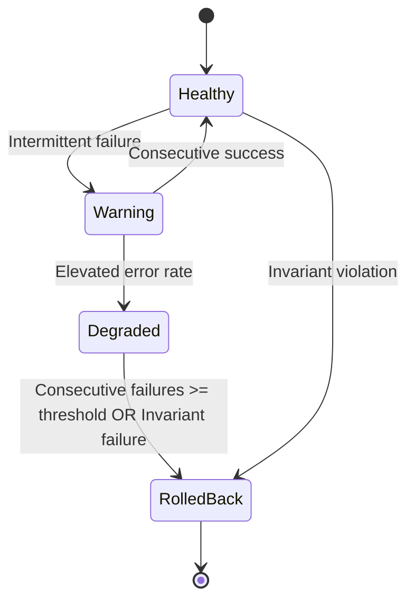

# Feature-Flag Rollout Guard with Automatic Rollback Verification (Issue #239)

The Feature-Flag Rollout Guard provides a resilient, automated safety harness for introducing risky changes across the six core Soroban contract domains in Trellis:
- **Treasury** (sweeps, category balance rebalancing, withdrawal limits)
- **Aid** (batch disbursements, claim settlement pipelines, donor escrows)
- **Referral** (multi-tier commission calculations, reward distributions)
- **Governance** (snapshot voting, quorum calculations, proposal execution)
- **Oracle** (price feed aggregation, medianizers, quorum attestation)
- **Marketplace** (batch listings, auctions, escrow holds, royalty distributions)

The registry and evaluation engine reside in [`shared::rollout_guard`](../shared/src/rollout_guard.rs) and integrate seamlessly with [`shared::feature_flags`](../shared/src/feature_flags.rs).

---

## 1. Problem Statement & Motivation

Smart contract upgrades and behavioral changes in Soroban carry high operational risk:
- Once state is mutated or funds are transferred, rolling back requires deliberate, verifiable actions.
- Manual intervention during incidents is slow and error-prone; under rapid transaction flow, a bug in a new algorithm can quickly cascade into corrupted state or solvency discrepancies.
- Disabling a faulty feature flag without verifying post-rollback state consistency risks leaving behind orphaned records, unbalanced reserves, or corrupted tallies.

The **Rollout Guard** solves this by:
1. Scoping risky paths to canaried traffic slices using deterministic caller seeds.
2. Continuously monitoring invocation telemetry (error rates, consecutive failures, invariant results).
3. Automatically tripping emergency rollback upon detecting threshold breaches or invariant violations.
4. Formally verifying that post-rollback state is clean, consistent, and correctly routes to the legacy baseline path.
5. Blocking re-enablement until clean rollback verification has succeeded.

---

## 2. Core Model & Architecture

### 2.1 Scoping & Targets (`RolloutTarget`)

Rollout guards can scope risky paths either by specific typed feature flags or by modular domain:

```rust
pub enum RolloutTarget {
    Module(RolloutModule), // Treasury, Aid, Referral, Governance, Oracle, Marketplace
    Flag(FeatureFlag),     // TreasurySweepV2, AidDisbursementV2, etc.
}
```

### 2.2 Rollout Stages (`RolloutStage`)

Traffic progression follows disciplined stages:

| Stage | Typical Traffic (`rollout_bps`) | Purpose |
|---|---|---|
| `Disabled` | `0` (0%) | Gated path inactive; routes 100% to legacy fallback. |
| `Canary` | `100`–`500` (1–5%) | Early canary verification on non-critical traffic. |
| `Partial` | `2_500` (25%) | Extended observation under moderate real-world load. |
| `Majority` | `7_500` (75%) | Broad exposure while retaining fallback capacity. |
| `Full` | `10_000` (100%) | Full production rollout across all callers. |
| `RolledBack` | `0` (0%) | Emergency trip active; execution locked to legacy fallback until verified. |

### 2.3 Deterministic Bucketing

To prevent callers from flip-flopping across retries, traffic routing is calculated deterministically:

$$\text{bucket} = \text{caller\_seed} \pmod{10\,000}$$

If $\text{bucket} < \text{rollout\_bps}$, the caller proceeds to the canaried feature path (`GuardDecision::ProceedNew`); otherwise, the caller is safely routed to the legacy path (`GuardDecision::FallbackLegacy`).

---

## 3. Telemetry & Health Monitoring

The guard tracks runtime execution metrics in contract instance storage:

```rust
pub struct RolloutHealthMetrics {
    pub total_invocations: u32,
    pub successful_invocations: u32,
    pub failed_invocations: u32,
    pub consecutive_failures: u32,
    pub last_error_code: u32,
    pub last_failure_ledger: u32,
    pub health_status: GuardHealthStatus,
}
```

### Health Status Transitions



- **`Healthy`**: Error rates and consecutive failures are zero or within normal baseline.
- **`Warning`**: Isolated failures observed; consecutive failures `< max_consecutive_failures`.
- **`Degraded`**: Error rate approaching threshold; new traffic throttled back to legacy path.
- **`RolledBack`**: Anomaly or threshold breached; automatic rollback triggered.

---

## 4. Automatic Rollback Triggers

Automatic rollback is tripped without requiring human intervention when any of the following occur:

1. **Consecutive Failure Threshold Exceeded**:
   $$\text{consecutive\_failures} \ge \text{max\_consecutive\_failures}$$
   *(Default: 3 consecutive errors)*

2. **Error Rate Limit Breached**:
   $$\frac{\text{failed\_invocations} \times 10\,000}{\text{total\_invocations}} > \text{max\_error\_rate\_bps}$$
   Evaluated once $\text{total\_invocations} \ge \text{min\_sample\_size}$ *(Default: 10% over $\ge 10$ calls)*.

3. **Invariant Violation (Zero Tolerance)**:
   Any transaction where $\text{invariant\_passed} = \text{false}$ (e.g. token balance mismatch, solvency discrepancy) immediately trips rollback on the first failure.

### Actions Executed on Auto-Rollback

When tripped, `trigger_auto_rollback` executes atomically:
1. Updates `RolloutGuardConfig`: sets `enabled = false`, `rollout_bps = 0`, `stage = RolloutStage::RolledBack`.
2. If a `FeatureFlag` is targeted, calls `feature_flags::emergency_disable(env, &flag)`.
3. Sets `health_status = GuardHealthStatus::RolledBack`.
4. Writes an immutable `RollbackAuditRecord` with failing error code, ledger number, and telemetry snapshot.
5. Emits contract event: `("rollout", "rollback")` with target symbol, reason code, and error code.

---

## 5. Automatic Rollback Verification

Tripping rollback is only half the requirement. To satisfy strict safety guarantees:
> **"risky changes can be scoped, monitored, rolled back, and verified without leaving inconsistent state behind."**

The function `verify_rollback(env, target, snapshot)` runs an exhaustive validation suite:

```rust
pub fn verify_rollback(
    env: &Env,
    target: RolloutTarget,
    snapshot: &ModuleConsistencySnapshot,
) -> RollbackVerificationReceipt
```

### Consistency Checks Evaluated

| Check | Target State | Failure Anomaly |
|---|---|---|
| **1. Guard Disabled** | `config.enabled == false` | `StateAnomalyKind::FlagStillEnabled` |
| **2. Rollout Zeroed** | `config.rollout_bps == 0` | `StateAnomalyKind::RolloutBpsNotZeroed` |
| **3. Stage Marked** | `config.stage == RolloutStage::RolledBack` | `StateAnomalyKind::StageNotRolledBack` |
| **4. Underlying Flag Zeroed** | `flag_config.enabled == false && flag_config.rollout_bps == 0` | `StateAnomalyKind::FlagStillEnabled` |
| **5. Legacy Routing Verified** | All seeds (`0`, `2500`, `5000`, `7500`, `9999`) return `FallbackLegacy` | `StateAnomalyKind::LegacyFallbackBypassed` |
| **6. Solvency & Reserves** | `snapshot.reserves_solvent == true` | `StateAnomalyKind::SolvencyDiscrepancy` |
| **7. No Orphaned Records** | `snapshot.records_consistent == true` | `StateAnomalyKind::OrphanedPartialRecord` |
| **8. Invariant Tallies Intact** | `snapshot.invariants_intact == true` | `TallyMismatch` / `StalePriceOrQuorumDeficit` / `EscrowMismatch` |

### Module-Specific Invariant Guarantees

- **Treasury**: Contract token reserves strictly equal tracked liabilities across all asset categories.
- **Aid**: No beneficiaries left in an unfinalized, half-disbursed state; aid status returns to valid baseline.
- **Referral**: Accrued referral commissions match finalized payout claims; referrer graph is intact.
- **Governance**: Vote tallies match submitted voter weight; proposal execution status reflects true ledger state.
- **Oracle**: Price feeds strictly fallback to last valid canonical checkpoint; quorum and timestamp monotonicity confirmed.
- **Marketplace**: Active listings match escrowed tokens; no split ownership or negative asking price.

### Re-Arming Guardrails

To prevent operators from prematurely re-enabling a faulty feature before the underlying issue has been identified and fixed:
`rearm_after_verified_rollback` rejects any re-enablement with `FeatureFlagError::UnverifiedRollbackReenableForbidden` unless `verify_rollback` has produced a receipt where `verified_clean == true`.

---

## 6. Operational Edge Cases & Failure Modes

### Edge Case 1: Intermittent vs Systematic Network Errors
- **Scenario**: Transient network timeout causes 1 call to fail.
- **Mitigation**: Consecutive failure counter resets to 0 upon any successful execution. Isolated hiccups generate `GuardHealthStatus::Warning` but do not trip rollback unless consecutive errors hit the threshold or the error rate over the sample window exceeds `max_error_rate_bps`.

### Edge Case 2: Partial State Mutation Before Revert
- **Scenario**: A complex multi-step transaction alters internal records before failing.
- **Mitigation**: Soroban host invocations rollback on contract error. Furthermore, `verify_rollback` evaluates `ModuleConsistencySnapshot::records_consistent`. If partial or orphaned state remains, `StateAnomalyKind::OrphanedPartialRecord` is flagged and `verified_clean` is set to `false`.

### Edge Case 3: Stale Client Canary Caching
- **Scenario**: An off-chain client assumes it is permanently on the new v2 path.
- **Mitigation**: The guard is evaluated on-chain inside the contract on every transaction. Once the guard is in `RolledBack` state, all callers immediately receive legacy execution regardless of client-side expectations.

### Edge Case 4: Rollback Re-Arming Race Condition
- **Scenario**: An operator attempts to bump the canary percentage back up while an investigation is ongoing.
- **Mitigation**: The guard enforces `is_rollback_verified`. Any attempt to set `enabled = true` without a passing `RollbackVerificationReceipt` returns `UnverifiedRollbackReenableForbidden`.

---

## 7. Operator Runbook & Recovery Steps

### 7.1 Inspecting Active Guard Status

```bash
# Query current guard configuration and health telemetry
soroban contract invoke \
  --id "$CONTRACT_ID" --network "$NETWORK" --source admin \
  -- get_guard_status --target "trs_v2"
```

### 7.2 Manual Rollback Initiation

```bash
# Emergency rollback: disable feature and route to legacy path immediately
soroban contract invoke \
  --id "$CONTRACT_ID" --network "$NETWORK" --source admin \
  -- trigger_manual_rollback --target "trs_v2" --reason "ManualTrigger"
```

### 7.3 Executing Rollback Verification

```bash
# Run automated verification and generate verification receipt
soroban contract invoke \
  --id "$CONTRACT_ID" --network "$NETWORK" --source admin \
  -- verify_rollback --target "trs_v2"
```

Review the returned receipt:
- If `verified_clean: true`: state is consistent and legacy routing is intact.
- If `verified_clean: false`: inspect `detected_anomaly` and follow module remediation.

### 7.4 Safe Re-Arming Post-Fix

Once the forward fix has been deployed and verified:

```bash
# Re-arm into fresh 5% canary
soroban contract invoke \
  --id "$CONTRACT_ID" --network "$NETWORK" --source admin \
  -- rearm_guard --target "trs_v2" --stage "Canary" --rollout_bps 500
```
