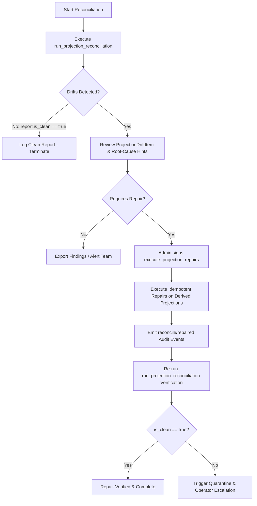

# Trellis Contracts: Projection Reconciliation Job

## 1. Overview & Purpose

Across Trellis Soroban contracts — **Treasury**, **Aid**, **Referral**, **Governance**, **Oracle**, and **Marketplace** — state is architected into two distinct layers:
1. **Canonical Source-of-Truth**: Immutable, authoritative state records written during foundational lifecycle events (e.g. reserve strategy positions, aid grants, multi-sig admin sets, verified oracle price submissions, NFT listings/auctions).
2. **Derived Projections & Secondary Indexes**: Materialized aggregates, running balances, paginated search pages, reverse vanity lookups, and voting tallies created to support low-latency querying, off-chain indexing, and gas-efficient reads.

Under conditions of high concurrency, partial transaction batch execution, storage TTL desynchronization, or historical upgrade migrations, derived projections can diverge from canonical truth. 

The **Reconciliation Job** (`shared::reconciliation`) resolves **Issue #238** by providing an automated, deterministic reconciliation and repair system with:
- **Dry-run-first safety**: Dry-run scanning is the default and is strictly read-only, mutating zero storage bytes.
- **Root-cause diagnostics**: Emits code-grounded explanations identifying the contract call or failed execution path responsible for each detected drift.
- **Canonical immutability**: Automated repairs mutate *strictly* derived projection keys, never source-of-truth records.
- **Strict idempotency**: Executing repairs multiple times produces deterministic results with zero side-effects.
- **Authorization gating**: Only verified contract administrators can trigger repairs.
- **Resource budget bounding**: Supports chunked, paginated scans to guarantee execution within Soroban CPU, memory, and ledger entry ceilings.

---

## 2. Module State Matrix: Canonical Truth vs. Derived Projections

| Module | Canonical Source of Truth | Derived / Cached Projection | Drift Type | Root Cause Lifecycle Triggers |
| :--- | :--- | :--- | :--- | :--- |
| **Treasury** | Positions: `(strat_pos, token, cat, strat)`<br>Approval: `(strat_ok, strat)` | Running Total: `(strat_tot, strat)`<br>Approved List: `strat_lst` | `RunningBalanceMismatch`<br>`MissingIndexEntry`<br>`OrphanedIndexEntry` | Missed decrement in `deallocate_reserve_strategy` / `revoke_reserve_strategy`, unharvested yield accounting drift, or strategy approved without vector push. |
| **Aid** | Canonical Records: `(aid_rec, id)`<br>Creation Counter: `aid_cnt` | Search Count: `srch_cnt`<br>Search Pages: `(srch_pg, page)`<br>Participant Counts: `(dnr_cnt, dnr)`, `(rcp_cnt, rcp)` | `CountMismatch`<br>`MissingIndexEntry`<br>`OrphanedIndexEntry` | Interrupted multi-aid transaction in `batch_create_aid`, or milestone settlement in `claim_aid` / `refund_aid` executing without updating participant index counters. |
| **Referral** | Vanity Owner: `(ref_code, code)`<br>Accruals: `(ref_acc, addr)`, `(ref_life, addr)` | Reverse Alias: `(ref_addr, addr)`<br>Invariants: `accrued <= lifetime` | `AsymmetricMapping`<br>`InconsistentState` | Asymmetric write during `set_referral_code`, or direct credit in `claim_commission` / `record_referral` without updating cumulative lifetime reward accumulator. |
| **Governance** | Admin Set: `adm_set`<br>Admin Approvals: `(approval, prop_id, admin)` | Admin Count: `adm_cnt`<br>Proposal Tally: `(proposal, prop_id)` | `CountMismatch`<br>`TallyMismatch` | `execute_proposal` added or removed an admin without updating `adm_cnt`, or approval cast / revoked without synchronizing `Proposal.approvals`. |
| **Oracle** | Verified Submissions: `(orc_subs, feed_id)` | Submitter Count: `(orc_cnt, feed)`<br>Latest Timestamp: `(orc_ts, feed)` | `CountMismatch`<br>`StaleTimestamp` | `submit_price` executed partial round aggregation, inactive submitter omitted from prune, or out-of-order submission write corrupted cached timestamp. |
| **Marketplace** | Canonical Listings: `(listing, id)`<br>Canonical Auctions: `(auction, id)` | Collection Listings: `(mkt_list, coll)`<br>Collection Auctions: `(mkt_auct, coll)` | `CountMismatch` | Omitted delta update `update_collection_stats(-1, 0)` during `buy_listing` / `cancel_listing` or `(0, -1)` during `finalize_auction` / `cancel_auction`. |

---

## 3. Drift Classification & Severity Levels

The engine itemizes findings into `ProjectionDriftItem` records with explicit operational severity:

### Severity Levels
- **`ReconciliationSeverity::Info`**: Minor telemetry, non-blocking cache divergence, or cosmetic ordering drift. Query paths continue to function normally.
- **`ReconciliationSeverity::Warning`**: Degraded discovery, missing search page entry, or counter drift. Critical balances remain intact, but pagination or user listings are incomplete.
- **`ReconciliationSeverity::Critical`**: Financial balance divergence, governance multi-sig count discrepancy, or mathematical invariant failure (`accrued > lifetime`). Demands immediate repair or transaction freeze.

### Drift Kinds
- `RunningBalanceMismatch`: Cached sum does not equal the arithmetic sum of underlying positions.
- `CountMismatch`: Materialized item count does not match the true count of canonical records.
- `MissingIndexEntry`: Canonical item exists in storage but is absent from the secondary index page.
- `OrphanedIndexEntry`: Secondary index references an ID that does not exist in canonical storage.
- `AsymmetricMapping`: 1:1 bidirectional binding is broken in one direction.
- `TallyMismatch`: Aggregated vote/approval count diverges from active approval records.
- `StaleTimestamp`: Projected latest timestamp lags behind the newest verified submission.
- `InconsistentState`: Arithmetic ceiling violation (e.g. claimable balance exceeding total earned).

---

## 4. Operator Workflow: Dry-Run vs. Repair



### Step 1: Run Dry-Run Reconciliation Scan
Dry-run execution uses `persistent_read` and `instance_get` without performing any state writes or TTL extensions:
```rust
use shared::reconciliation::{run_projection_reconciliation, ReconciliationScopeConfig};

let mut config = ReconciliationScopeConfig::new(&env);
config.treasury_strategies.push_back(strategy_address);
config.governance_proposal_ids.push_back(101);

let report = run_projection_reconciliation(&env, &config);

if !report.is_clean {
    for drift in report.drifts_detected.iter() {
        // Inspect module, entity, expected vs actual values, severity, and root cause hints
    }
}
```

### Step 2: Execute Authorization-Gated Repair
Repairs require the contract administrator identity and execute strictly on derived projection keys:
```rust
use shared::reconciliation::execute_projection_repairs;

// Administrator authenticates
let receipts = execute_projection_repairs(&env, &admin_address, &repair_instructions)?;

for receipt in receipts.iter() {
    // Audit previous_value vs new_value and execution ledger
}
```

---

## 5. Bounded Pagination & Resource Limits

Soroban contracts operate under strict CPU instructions and memory budget ceilings per transaction invocation. When reconciling large datasets (e.g. thousands of aid records or marketplace listings), scans must be bounded:

```rust
use shared::reconciliation::{run_paginated_projection_reconciliation, PaginationParams};

let mut offset = 0;
let page_limit = 50;

loop {
    let result = run_paginated_projection_reconciliation(
        &env,
        &all_drifts,
        &PaginationParams { offset, limit: page_limit },
    )?;

    process_drifts(&result.report.drifts_detected);

    if !result.has_more {
        break;
    }
    offset = result.next_offset;
}
```

---

## 6. Failure Modes & Rollback / Recovery Runbook

| Failure Mode | Symptom | Immediate Response | Recovery Runbook |
| :--- | :--- | :--- | :--- |
| **Unauthorized Caller** | `ReconciliationError::Unauthorized (970)` | Operation aborted immediately. | Verify caller address against `crate::auth::get_admin(&env)`. Confirm multisig threshold signature. |
| **Canonical Mutation Attempt** | `ReconciliationError::CanonicalMutationForbidden (973)` | Target key rejected before write. | Audit repair instructions. Ensure target keys are strictly projection keys (`strat_tot`, `srch_cnt`, `adm_cnt`, etc.). |
| **Invalid Pagination** | `ReconciliationError::InvalidPagination (971)` | Zero limit or invalid offset provided. | Supply valid `limit > 0` and `offset < total_entities`. |
| **Repeated Drift After Repair** | Drift recurs on subsequent scan. | Quarantine affected module. | Re-run dry-run scan. Inspect contract methods modifying the affected entity to ensure the underlying bug has been patched. |

---

## 7. Verification & Automated Test Coverage

The test suite in [`shared/src/test_reconciliation.rs`](../shared/src/test_reconciliation.rs) proves the operational guarantees:
1. `test_clean_state_projection_reconciliation`: Proves zero false-positives across all 6 core modules in clean state.
2. `test_treasury_drift_detection_and_root_cause`: Detects balance and whitelist drift with root-cause hints.
3. `test_aid_drift_detection_and_root_cause`: Detects search index count, page omissions, and donor/recipient count drift.
4. `test_referral_drift_detection_and_root_cause`: Detects asymmetric vanity mapping and ceiling invariant breaches.
5. `test_governance_drift_detection_and_root_cause`: Detects admin count and proposal tally drift.
6. `test_oracle_drift_detection_and_root_cause`: Detects submission count and timestamp staleness.
7. `test_marketplace_drift_detection_and_root_cause`: Detects active listing and auction count drift.
8. `test_dry_run_safety_guarantee`: Proves dry run performs zero storage mutations.
9. `test_repair_execution_and_canonical_immutability`: Proves repairs fix derived projections while leaving canonical state untouched.
10. `test_repair_idempotency`: Proves repeated repair execution produces identical, clean state without side-effects.
11. `test_repair_authorization_failure`: Proves unauthorized repair attempts fail with `Unauthorized (970)`.
12. `test_paginated_reconciliation_bounding`: Proves bounded window progression and cursor resumption.
