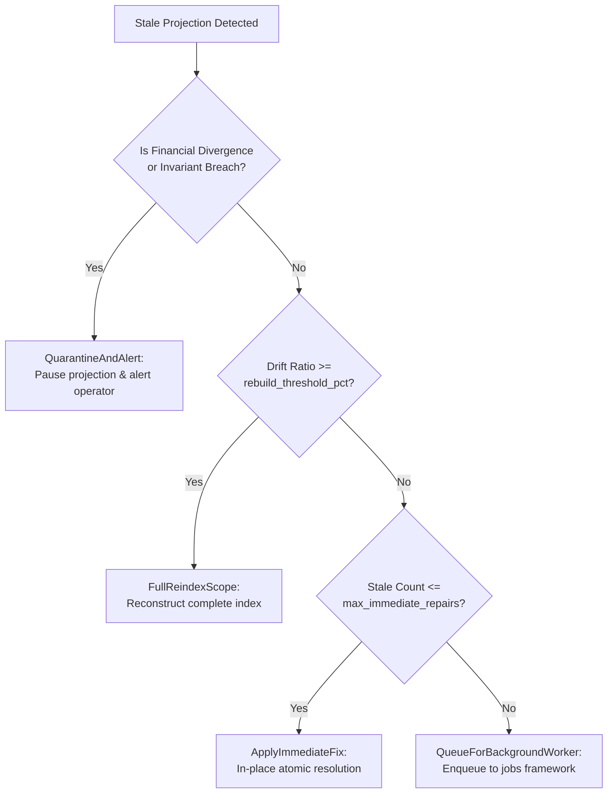

# Stale-Cache and Stale-Index Detection with Automated Repair Recommendations

Across the Trellis Soroban contract ecosystem — **Treasury**, **Aid**, **Referral**, **Governance**, **Oracle**, and **Marketplace** — high-performance query operations and operational workflows rely on secondary derived indexes and cached aggregate projections.

While canonical persistent records remain the immutable single source of truth, network concurrency, partial batch execution (e.g. `batch_create_aid`), TTL expiration thresholds, and asynchronous off-chain sync can introduce **projection drift**.

`shared::projection_repair` (Issue #252) introduces an automated detection, scoping, repair recommendation, and operator evidence framework to eliminate silent projection divergence without breaking backward compatibility.

---

## 1. Module Scopes and Projected State Catalog

| Module | Projection Scope | Kind | Canonical Source of Truth | Drift Consequence |
|---|---|---|---|---|
| **Treasury** | Whitelisted Strategy Index (`strat_idx`) | Index | `strategies` vector | Strategy de-allocation fails or routing fails |
| **Treasury** | Category Reserve Cache (`cat_bal`) | Cache | Aggregate category deposits - withdrawals | False insolvency triggers or deposit limit rejections |
| **Aid** | Discovery Search Index (`search`) | Index | Canonical `AidRecord` entities | Search omission or non-claimable phantom listings |
| **Aid** | Donor & Recipient Indices (`donor_aid`) | Index | Append-only participant ID sets | Incomplete historical query or pagination truncation |
| **Referral** | Upline / Downline Tree (`downline`) | Index | Canonical `ReferralEdge` records | Commission attribution failure or tier miscalculation |
| **Referral** | Accrued Commission Cache (`comm_acc`) | Cache | Sum of unwithdrawn commission events | Premature withdrawal rejection or balance discrepancy |
| **Governance** | Active Proposals Index (`act_prop`) | Index | `ProposalRecord` where status == Active | Proposals unreachable for voting or execution |
| **Governance** | Vote Tally Projections (`tally`) | Cache | Individual cast `BallotRecord` entries | Erroneous quorum decisions or invalid executions |
| **Oracle** | Price Feed Registry (`feed_reg`) | Index | Active registered oracle asset pairs | Asset pricing unavailability |
| **Oracle** | Latest Price Round Cache (`price_rnd`) | Cache | Latest sequential price round attestation | Rejection of valid contracts due to stale data |
| **Marketplace** | Collection Listings Index (`listing`) | Index | Open `ListingRecord` items | Sold/canceled NFTs lingering as ghost listings |
| **Marketplace** | Collection Floor Price Cache (`floor_p`) | Cache | Minimum active ask price in collection | Erroneous market statistics and valuation drift |

---

## 2. Staleness & Drift Taxonomy

The framework evaluates indexes and caches against formal invariant rules:

```text
                               ┌─────────────────────────────┐
                               │ Canonical State Inspection   │
                               └──────────────┬──────────────┘
                                              │
                      ┌───────────────────────┴───────────────────────┐
                      ▼                                               ▼
         [Derived Index Evaluation]                      [Cached Aggregate Evaluation]
         - Missing entry in index                        - Counter / sum mismatch
         - Orphaned entry in index                       - Financial balance divergence (CRITICAL)
         - Ordering violation or duplicates              - Ledger lag beyond max tolerance
         - Ledger update lag                             - Cryptographic checksum mismatch
```

### Drift Kinds (`StaleDriftKind`)
1. **`MissingIndexEntry`**: A canonical record exists in persistent storage, but is absent from the derived search or participant index.
2. **`OrphanedIndexEntry`**: The index contains a pointer/ID to an entity that was deleted or settled.
3. **`StaleCounterMismatch`**: Materialized counters or cached balances diverge from the computed sum of individual canonical entries.
4. **`LagsCanonicalLedger`**: The projection's last updated ledger exceeds `current_ledger - max_lag_ledgers_tolerance`.
5. **`IndexOrderingOrDuplicateDrift`**: An index contains duplicate entries or violates monotonic ordering (breaks binary search/cursor pagination).
6. **`TtlDesynchronized`**: The TTL on temporary/persistent index entries is near expiry or out of alignment with underlying records.
7. **`ChecksumMismatch`**: Hash/fingerprint of the projected state differs from canonical inputs.

---

## 3. Automated Repair Recommendations

Each finding is evaluated by `recommend_repair` using risk-weighted logic:



### Recommendation Policies
- **`ApplyImmediateFix`**: Applied synchronously for small batches ($\le 10$ items). Missing items are appended, orphans purged, and counters fast-forwarded.
- **`QueueForBackgroundWorker`**: Defers execution to background worker bots via `shared::jobs` or internal repair queue when invocation gas limits would be exceeded.
- **`FullReindexScope`**: Reconstructs the index from scratch when more than 30% of entries are corrupted or misordered.
- **`QuarantineAndAlert`**: Triggered when a financial discrepancy or critical reserve invariant is violated. Prevents automated mutation from compounding financial errors.

---

## 4. Operator Evidence & Audit Receipts

Every repair run creates an immutable `ProjectionAuditReceipt`:

```rust
pub struct ProjectionAuditReceipt {
    pub receipt_id: u64,
    pub module: ProjectionModule,
    pub executed_ledger: u32,
    pub total_scanned: u32,
    pub stale_detected: u32,
    pub repaired_count: u32,
    pub queued_count: u32,
    pub quarantined_count: u32,
    pub pre_repair_fingerprint: u64,
    pub post_repair_fingerprint: u64,
    pub actions: Vec<ProjectionRepairAction>,
    pub clean: bool,
}
```

### Event Monitoring
The framework publishes auditable two-topic Soroban events:
- `("proj_rep", "audit")` $\to$ `(module, receipt_id, repaired_count, queued_count)`
- `("proj_rep", "repaired")` $\to$ `(module, queue_id, affected_id)`
- `("proj_rep", "queued")` $\to$ `(module, queue_seq, affected_id)`
- `("proj_rep", "quarantine")` $\to$ `(module, receipt_id, quarantined_count)`
- `("proj_rep", "rollback")` $\to$ `(module, receipt_id, restored_count)`

---

## 5. Operational Edge Cases & Failure Modes

### 5.1 Concurrent Writes During Re-indexing
- **Risk**: An index is being recomputed while a user creates a new record.
- **Mitigation**: Scoped locks or timestamp gating; index updates compare ledger sequences and only advance forward.

### 5.2 Storage TTL Expiry During Deferred Queueing
- **Risk**: Queued repair items expire in temporary storage before a crank bot processes them.
- **Mitigation**: Queue items are stored in instance storage with persistent fallback, immune to premature eviction.

### 5.3 Partial Failure in Batch Processing
- **Risk**: Worker fails halfway through a repair batch.
- **Mitigation**: Items are processed individually with atomic checkpoint flags (`processed: bool`); replays do not duplicate work.

### 5.4 Financial Divergence / Insolvency Protection
- **Risk**: Automated repair forcibly overwrites a lower treasury reserve cache to match a higher canonical claim liability, hiding an actual token deficit.
- **Mitigation**: Financial divergences are classified as `Critical` and routed to `QuarantineAndAlert`. Automated repairs NEVER unilaterally manufacture reserve backing.

---

## 6. Rollback & Recovery Runbook

If a repair operation introduces unintended behavior or downstream query regressions, operators can instantly restore prior state:

### 6.1 Inspecting Stale Projections (Dry-Run Preview)
```rust
let receipt = execute_or_queue_projection_repair(&env, module, &items, true /* dry_run */)?;
```

### 6.2 Executing In-Place Repair
```rust
let receipt = execute_or_queue_projection_repair(&env, module, &items, false /* execute */)?;
```

### 6.3 Processing Background Repair Queue
```rust
let pending = get_pending_queue_count(&env, module);
for i in 0..pending {
    process_queued_repair(&env, module, i)?;
}
```

### 6.4 Emergency Rollback Execution
When an audit receipt indicates an unintended state transition:
```rust
let rollback_receipt = rollback_projection_repair(&env, receipt_id)?;
```
1. Retrieves the pre-repair snapshot from `ProjectionStorageKey::RollbackSnapshot(receipt_id)`.
2. Restores prior projected values and index state.
3. Invalidates the rollback snapshot to prevent duplicate rollbacks.
4. Publishes `("proj_rep", "rollback")` event for telemetry and monitoring.
